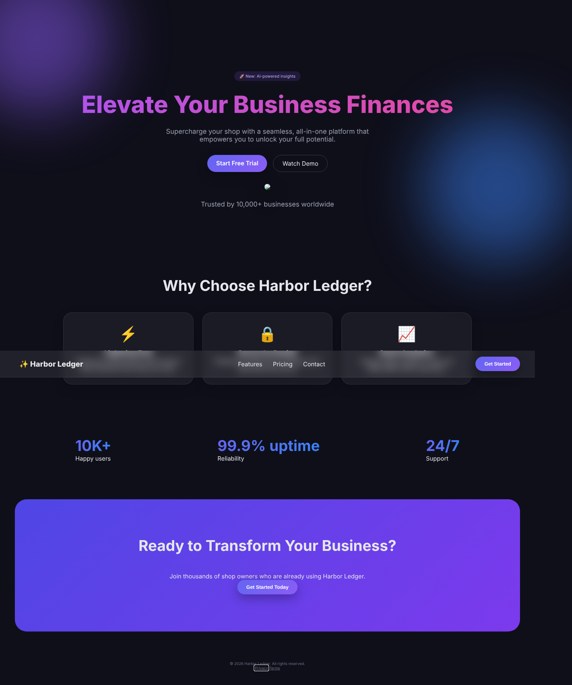
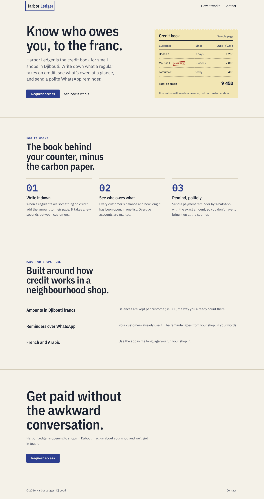

<div align="center">

# ANTI-SLOP

### Stop generating generic websites. Start creating unforgettable digital experiences.

A Claude Code skill that makes AI-built frontends **look intentional, work for real,
and prove it** — creative direction before code, a design system you can trace,
and verification in a real browser.

*Every interface should have a reason to look the way it looks.*

[Install](#install) · [What it does](#what-it-does) · [Before / after](#a-real-run) · [Tools](#the-tools) · [Benchmark](#benchmark-status) · [Contributing](CONTRIBUTING.md)

</div>

---

## The problem

Ask an AI to build a website and you get the same one: indigo-to-violet
gradient, Inter, a glassy navbar, a centered hero, three rounded feature cards
with emoji, "Elevate your workflow", "Trusted by 10,000+ teams" — and half the
buttons go nowhere.

That's not a bug. For every decision nobody constrained, the model picks the
most probable answer: the average of everything it has seen. Banning purple
just moves the average. Picking "brutalist" off a menu creates a new average.

**The only reliable source of a non-average result is a non-average input —
the specific product, its users and its content.** ANTI-SLOP makes Claude
gather that input first, derive every visual decision from it, write the
decisions down, build with real functionality, and verify with evidence.

## What it does

```
UNDERSTAND   product, audience, objective — from the repo first, ≤3 questions
ANALYZE      stack, conventions, baseline scan + real-browser check
DIRECT       evidence → tensions → direction family → material metaphor → signature move → refusals
SYSTEMATIZE  type, color, space, shape, depth, motion as tokens → DESIGN.md (identity lock)
BUILD        one of 10 workflows; real states; nothing fake
VERIFY       static scan · 3-viewport browser check · click-everything checklist · 44-point rubric
```

**What makes it different**

| | |
|---|---|
| 🧭 **Direction from evidence** | 18 direction families, each with "evidence that justifies it", "evidence against" and its own generic failure mode. A sibling test rejects directions that any product would get. |
| 🔍 **41-rule static scanner** | Aesthetic tells *and* the engineering failures that travel with them: dead links, no-op handlers, unwired forms, clickable divs, removed focus, blocking fonts. Web, Flutter, SwiftUI, Compose. Scores per category. |
| 🖥️ **Real-browser page check** | Playwright at 390 / 820 / 1440: overflow culprits, tap targets, contrast of rendered text, focus visibility across Tab stops, dead links, console errors, and the fonts and colors *actually rendered*. Screenshots for you to review. |
| 🛠️ **Real functionality** | No fake dashboards, invented metrics, dead buttons or forms that pretend to submit. If it can't work yet, it says so on screen. |
| 🔒 **Identity lock** | `DESIGN.md` + one line in `CLAUDE.md`/`AGENTS.md` so the next session doesn't drift back to defaults. |
| 🧪 **Honest evaluation** | 10 benchmark scenarios, a blind A/B harness, a repeatable rubric, 41 rule regression tests. No fabricated results. |
| 🌍 **Locale-aware** | RTL, Arabic/CJK/Devanagari type choices, logical CSS properties. |

## A real run

`examples/harbor-ledger/` is one end-to-end run of the `fix-ai-generated`
workflow on a deliberately generic page for a fictional bookkeeping app for
small shops in Djibouti. [Full report →](examples/harbor-ledger/REPORT.md)

| | Before | After |
|---|---|---|
| Static scan | **0**/100 | **100**/100 |
| Browser-check issues (3 viewports) | **19** | **0** |
| Dead links | 7 | 0 |
| Direction | *the default* | Swiss + "duplicate receipt book"; signature move: a carbon-copy offset on key figures |

| Before | After |
|---|---|
|  |  |

Clicking through the form in a real browser found a bug no scanner caught (a
collapsing error message shifted the submit button under the pointer). It was
fixed, and the lesson became a rule in the skill. That's the loop the skill
is built around.

> Honesty note: the "before" page was hand-written to represent generic AI
> output; this is a demonstration, not a benchmark. See [benchmark status](#benchmark-status).

## Install

**Global (all projects):**
```bash
git clone https://github.com/abdo877-sys/anti-slop.git
cd anti-slop && ./install.sh            # → ~/.claude/skills/anti-slop
```
**One project (commit it so your team gets it):**
```bash
/path/to/anti-slop/install.sh --project  # → ./.claude/skills/anti-slop
```
**Codex / other agents that read SKILL.md:** `./install.sh --agents`
**Manual:** copy `skills/anti-slop/` into any skills directory.

Requirements: Python 3.8+ (standard library only).
Optional for browser checks: `pip install playwright && python3 -m playwright install chromium`.

## Use it

It activates on its own for frontend work. Or ask directly:

- *"Build a site for my bakery in Marseille — it should look like us, not a template."*
- *"This landing page looks AI-generated. Fix it."*
- *"Redesign our docs site but keep every URL working."*
- *"Audit the frontend quality of this app. Don't change anything."*
- *"Build a dashboard for our 12 solar sites."*

## The workflows

| | |
|---|---|
| New website from scratch | Redesign an existing site |
| Premium portfolio | SaaS application UI |
| E-commerce | Creative agency |
| Dashboard | Improve a UI (no redesign) |
| **Fix a generic AI-generated design** | Frontend quality audit (read-only) |

Each has concrete steps and its own quality checks — see [`skills/anti-slop/workflows/`](skills/anti-slop/workflows).

## The tools

```bash
S=~/.claude/skills/anti-slop/scripts
python3 $S/slop_scan.py .                          # report with fixes, file:line
python3 $S/slop_scan.py . --json > before.json     # save a baseline
python3 $S/slop_scan.py . --compare before.json    # before → after per category
python3 $S/slop_scan.py . --md report.md           # markdown report
python3 $S/slop_scan.py . --fail-under 80          # CI gate
python3 $S/slop_scan.py --list-rules               # the 41 rules
python3 $S/page_check.py http://localhost:3000     # real-browser check + screenshots
python3 $S/contrast_check.py "#4F5566" "#F4F1E8"   # WCAG contrast
```

A high scan score means *no known code-level tells* — not "well designed".
That's why the gate also needs the browser check, the functionality checklist
and the rubric.

## Repository layout

```
skills/anti-slop/          ← the installable skill
  SKILL.md                 principles, mandatory workflow, routing (152 lines; loads the rest on demand)
  workflows/               10 specialised workflows
  references/              creative direction, typography, color, layout, motion, components,
                           engineering, research, browser testing, AI tells
  checklists/              preflight, quality gate, functionality, accessibility, performance
  evaluation/              rubric + 10 benchmark scenarios
  templates/               creative brief, DESIGN.md, quality report
  scripts/                 slop_scan.py, page_check.py, contrast_check.py
bench/                     A/B harness + seed projects
examples/harbor-ledger/    a real before/after run with screenshots and report
tests/                     rule regression tests
tools/validate_skill.py    structure & link validator (runs in CI)
```

## Benchmark status

The harness is ready (`bench/run_benchmark.py`): same prompt, two arms
(default vs. skill installed at project level), automated scans, and a
**blind** A/B kit for human rubric scoring. **No comparative results have been
published yet** — we'd rather ship none than invented ones. Running it needs
your own Claude Code access; results PRs are very welcome (losses included).

## Contributing

The most valuable contributions: **a tell we miss** (with a fixture), **a false
positive** (with a fixture), **benchmark runs**, and **direction families or
worked examples** from domains we haven't covered. See [CONTRIBUTING.md](CONTRIBUTING.md).

## License

MIT. The example uses IBM Plex fonts under the SIL Open Font License.
