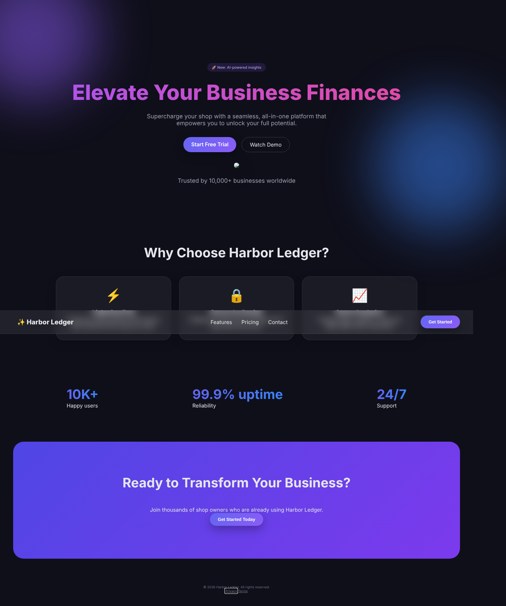
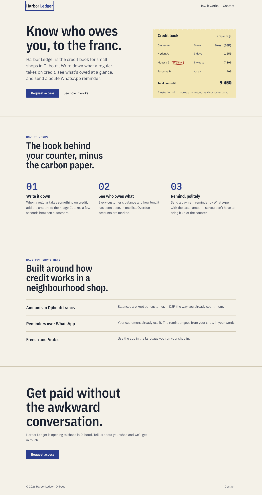

# Harbor Ledger — before/after with ANTI-SLOP (fix-ai-generated workflow)

**What this is:** a real run of the skill's `fix-ai-generated` workflow on a
seed page, performed by Claude (Opus 5.5) following `SKILL.md` while authoring
the skill. **What it is not:** a benchmark against default Claude Code. The
"before" page was hand-written to be representative of generic AI output — it
was not captured from a model. See `../../bench/` for the real comparison
harness (not yet run).

| | Before | After |
|---|---|---|
| Static scan (`slop_scan.py`) | **0** / 100 (identity 0, function 76, a11y 68, perf 98) | **100** / 100 |
| Rendered-page issues (`page_check.py`, 3 viewports, HTTP) | 19 | 0 |
| Rendered fonts | Inter | IBM Plex Sans / Condensed / Mono |
| Dead links | 7 | 0 (all 4 unique links return 200) |

Mobile: [`screens/before-mobile.png`](screens/before-mobile.png) · [`screens/after-mobile.png`](screens/after-mobile.png)

## Verified (and how)
- Static scan before/after: `after/.anti-slop/scan.md`.
- `page_check.py` at 390 / 820 / 1440 on `index.html` and `contact.html`,
  served over HTTP (`python -m http.server`), Chromium via Playwright.
- Screenshots reviewed by eye at desktop and mobile; one defect found and fixed
  (footer link misaligned with the copyright line).
- Keyboard: first Tab reaches the skip link; Enter moves to `#main`; across 20 Tab
  presses every focused element showed a visible focus ring.
- Form operated in the browser: empty submit → 3 errors, focus on first invalid
  field; bad phone → specific message, focus on phone; valid submit → honest
  "not connected" message; input preserved.
- **Bug found by clicking, not by any scanner:** errors disappearing on blur
  shifted the layout so the submit click missed. Fixed in `contact.js`, and the
  lesson was added to `references/components.md` and `checklists/functionality.md`.
- Palette contrast pairs checked with `contrast_check.py` (all text ≥ 5.3:1).

## Not verified
- Performance metrics (no Lighthouse run); only static performance checks.
- Real WebKit/Safari rendering.
- French and Arabic versions (not built — the seed page was English).
- Form delivery (no endpoint exists; the form says so).

## Rubric (self-scored by the author — not blind)
| Dimension | Score | Evidence |
|---|---|---|
| Visual originality | 3 | 0/10 default axes; specimen + carbon move are product-specific; a blind scorer should confirm 3 vs 4 |
| Design coherence | 4 | every token traced in `.anti-slop/brief.md`; refusals respected |
| Typography | 3 | one Plex family in three roles, tabular amounts; scale has 5 steps |
| Layout composition | 3 | 7/5 statement + specimen, numbered sequence, ledger rows; third section is the weakest |
| Spacing | 3 | single scale; proximity grouping |
| Color consistency | 4 | palette from the metaphor, semantic tokens, contrast verified |
| Responsive behavior | 3 | recomposes at 60rem; no overflow 390–1440 |
| Accessibility | 3 | automated checks + keyboard walk pass; no screen-reader test |
| Interaction quality | 3 | all states designed; form bug found and fixed |
| Performance | 2 | self-hosted subset fonts, no JS on index; not measured |
| Code quality | 3 | tokens, cascade layers, no dependencies |
| **Total** | **34 / 44** | Below the 36 gate on self-score: Performance would rise with a measured Lighthouse run; Layout with a stronger third section. |

## Removed from the original — the owner must confirm or supply
"Trusted by 10,000+ businesses", "10K+ happy users", "99.9% uptime", "24/7
support", the "AI-powered insights" badge, "Watch Demo", "Pricing", "Privacy",
"Terms", and the Unsplash hero photo.
